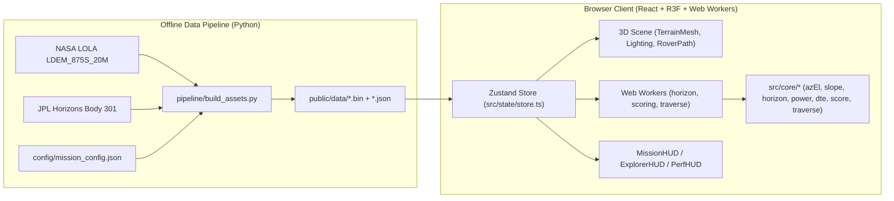

# RegolithForge — Lunar South Pole Landing Site Navigator

An offline-first interactive 3D lunar south-pole landing-site navigator and mission trainer centered on **Shackleton Crater** and the **Connecting Ridge** (`89.9° S`), built for the **2026 NASA Space Apps Challenge** (*Lunar Landing Site Navigator*, with secondary tracks *Earth Analogs for Lunar Outposts* and *Junior Astronaut Mission Trainer*).

---

## Key Capabilities

- **Real NASA Terrain & Ephemeris (`REAL` provenance):** Pre-processed 1024×1024 Float32 slice (`20 m/px`) of NASA LRO/LOLA south-polar topography (`LDEM_875S_20M`) paired with JPL Horizons airless lunar-surface ephemeris (`observer_body=301`, Sun/Earth azimuth, elevation, and heliocentric/topocentric range).
- **Curvature-Aware Horizon Raycaster (`DERIVED`):** Computes 360° terrain horizon masks with lunar curvature drop `h_eff(d) = h(d) - d²/(2R)` (`R = 1,737,400 m`), solar disc partial illumination (`~0.53°` angular diameter), and `(1 AU / r)²` irradiance scaling.
- **Configurable Solar & DTE Telemetry:** Supports vertical azimuth-tracking, fixed horizontal, and two-axis tracking arrays with adjustable mast height; computes Direct-to-Earth (DTE) geometric line-of-sight (`Geometric LOS`), one-way light time (`~1.28 s`), free-space path loss (FSPL), and DSN complex visibility (Goldstone, Madrid, Canberra).
- **Shader Hazard & Thermal Overlays:** Fragment-shader slope hazard grading (adjustable threshold, default `15°`, with explicit `DEM-resolution-limited (20 m/px)` warning) and derived PSR/thermal proxy overlay, plus Okabe-Ito color-blind-safe palette toggle.
- **Mission Planner & Explorer (2 m) Modes:** Multi-site A/B/C comparison, multi-criteria Site Finder, A* rover traverse planner with animated 3D rover, 3-sigma landing uncertainty ellipse, Earth analog comparison modal, and 2 m first-person Explorer mode with guided learner challenges.
- **Accessibility & Shortcuts:** `Space` (play/pause timeline), `←`/`→` (step ±1h), `E` (toggle Planner/Explorer), `P` (toggle Perf HUD), and `prefers-reduced-motion` support.

---

## Architecture



---

## Running Locally

### 1. Frontend & Tests

```bash
npm install
npm run dev       # Starts Vite dev server (http://localhost:5173)
npm run build     # TypeScript check + production bundle (dist/)
npm test          # Vitest math & 3D-vs-HUD consistency unit tests
```

### 2. Offline Data Pipeline (Optional — Pre-cached assets are already in `public/data/`)

```bash
uv run --with numpy --with requests --with rasterio --with pyproj python pipeline/build_assets.py
uv run --with numpy python pipeline/test_pipeline.py
```

---

## Known Limitations

- **DEM-resolution-limited (20 m/px):** Meter-scale boulders, regolith roughness, and small craters below `20 m` are not resolved by `LDEM_875S_20M`.
- **Geometric LOS Only:** DTE calculations report geometric line-of-sight, range, light time, and FSPL — not a full RF link budget with antenna gain/atmospheric attenuation.
- **Derived Thermal / Ice Proxies:** Subsurface temperature and PSR ice proximity overlays are derived proxies from elevation and solar illumination, not direct Diviner/Mini-RF measurements.

---

## Data Attribution & Compliance

- **Topography:** NASA Lunar Reconnaissance Orbiter (LRO) / Lunar Orbiter Laser Altimeter (LOLA) `LDEM_875S_20M` via NASA PDS Geosciences Node / USGS Astrogeology.
- **Ephemeris:** NASA/JPL Horizons System (`observer_body = 301`).
- **Disclaimer:** RegolithForge is an independent NASA Space Apps Challenge project. It is **not** affiliated with, endorsed by, or an official product of NASA or JPL, and uses no NASA logos.

## AI Tool Usage Disclosure

This project was engineered with assistance from an AI coding assistant (Antigravity / Gemini) for architecture planning, TypeScript/GLSL/Python implementation, test generation, and documentation, with all physics equations, JPL Horizons outputs, and live browser renders verified against reference values and automated tests.
